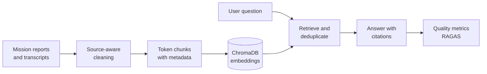

# Space Mission Research Assistant

Ask questions about NASA mission reports and transcripts, and get answers that
cite the source passages they rely on.

| | |
|---|---|
| **Problem** | Mission archives are long and noisy: OCR errors, page furniture, tables, and transcript formatting make them hard to search and easy to misquote. |
| **Approach** | Source-aware cleaning, token-based chunking, embeddings in a persistent vector database, and answers that must cite retrieved evidence, with automated quality evaluation. |
| **Results** | 5,584 chunks indexed from 12 Apollo 11, Apollo 13, and Challenger sources. On a 17-question benchmark, faithfulness is 0.82 and answer relevancy 0.78; retrieval completeness (recall 0.50) is the identified improvement target. |
| **Stack** | Python · OpenAI embeddings and chat models · ChromaDB · RAGAS · Streamlit · pytest (108 tests) · GitHub Actions · uv |

## How it works



1. **Clean** each source with rules suited to its format, keeping narrative text
   and provenance while dropping OCR noise and unusable tables.
2. **Chunk and embed** the cleaned text into a persistent ChromaDB collection,
   with mission, source, and file metadata on every chunk.
3. **Retrieve** the most relevant passages, optionally filtered by mission, and
   deduplicate them.
4. **Answer** with a prompt that requires citations and explicit uncertainty
   when the evidence is insufficient.
5. **Evaluate** answers in real time in the chat app, or across a benchmark set
   in batch.

## Key design decisions

- **Clean before chunking.** Embeddings cannot separate meaningful text from
  OCR artifacts once they are mixed, so cleaning happens first and is tailored
  to each source type rather than applied as one generic pass.
- **Chunk within each source file.** Overlap never crosses file boundaries, so
  every retrieved passage traces back to a single document.
- **Synchronize instead of append.** A `replace` update mode upserts current
  chunks and deletes stale ones, so changing the cleaning or chunking rules
  never leaves outdated text in the index.
- **Ground every answer.** Retrieved context is supplied only for the current
  question, answers must cite it, and the model is told to state uncertainty
  rather than fill gaps from general knowledge.
- **Fail per metric, not per run.** A failed evaluation metric is recorded as a
  structured error while the remaining metrics and questions continue.

## Results

The 2026-07-28 benchmark run completed all 17 questions with no failures.

| Metric | Mean | What it shows |
|---|---:|---|
| Faithfulness | 0.82 | Most answer claims are supported by the retrieved evidence. |
| Response relevancy | 0.78 | Answers generally address the question asked. |
| Context precision | 0.56 | Useful evidence is only moderately concentrated at the top of the ranking. |
| Context recall | 0.50 | Retrieval covers about half of the reference-answer claims. |
| Factual correctness | 0.30 | Answers align weakly with the reference answers overall. |

Answers are well grounded in what is retrieved, but retrieval is incomplete, so
the next improvement is retrieving more complete, reference-relevant evidence.
Full per-question results are in
[`evaluation_results_2026-07-28.json`](evaluation_results_2026-07-28.json), and
the [evaluation guide](docs/evaluation.md) explains each metric.

## Limitations

- Conservative cleaning cannot remove every OCR or speech-recognition error
  without risking the loss of useful content.
- Exact-text deduplication does not catch every near-duplicate passage.
- Model-based evaluation is stochastic, and live runs incur API cost.
- Answers must cite sources, but no separate verifier yet checks that each
  citation supports its claim.

## Running locally

Requires Python 3.12, [uv](https://docs.astral.sh/uv/), and an OpenAI-compatible
API key in a local `.env` file (`OPENAI_API_KEY`, optionally `OPENAI_BASE_URL`).

```bash
uv sync
uv run python -m pytest -q
uv run python embedding_pipeline.py --data-path data_text --update-mode replace
uv run streamlit run chat.py
```

The [operations guide](docs/operations.md) covers every command and option,
including the batch evaluation.

## Repository structure

```text
.
├── data_text/                  # Mission OCR and transcript source files
├── docs/                       # Operations, evaluation, and data-cleaning guides
├── tests/                      # 108 automated tests
├── nasa_text_cleaners.py       # Source-aware OCR and transcript cleaning
├── embedding_pipeline.py       # Chunking, embedding, ChromaDB persistence, CLI
├── rag_client.py               # Retrieval and context construction
├── llm_client.py               # Grounded answer generation
├── ragas_evaluator.py          # RAGAS metric evaluation
├── chat.py                     # Streamlit chat interface
├── batch_evaluation.py         # Benchmark evaluation CLI
├── test_questions.json         # 17 questions with reference answers
└── evaluation_results_2026-07-28.json
```

Not affiliated with or endorsed by NASA.
